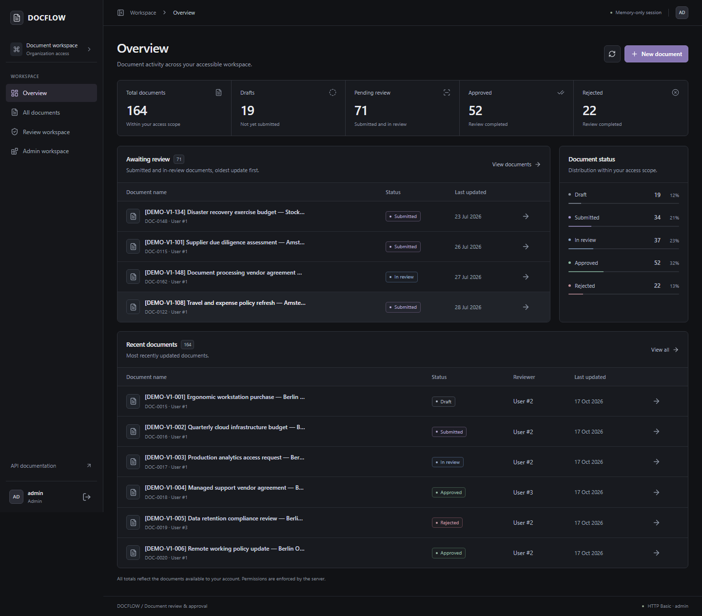
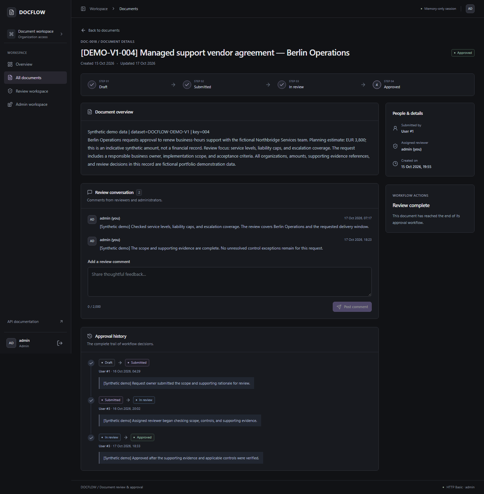
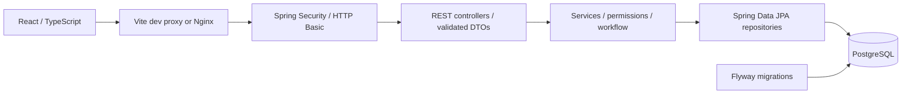
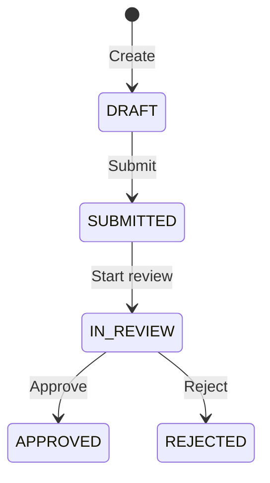

# DOCFLOW — Document Review & Approval System

A full-stack workflow application for submitting documents, reviewing assigned work, and recording approval decisions. Built with Spring Boot and React, DOCFLOW demonstrates server-enforced permissions, explicit state transitions, persistent audit history, and automated browser testing.

> Portfolio application for local development and demonstration. Public deployment requires additional operational and security work; see [limitations](#security-and-known-limitations).

## Features

- Separate submitter, reviewer, and administrator workspaces.
- Draft creation, reviewer assignment, submission, approval, and rejection.
- Search by title and filter by status; role-scoped dashboard totals from real API data.
- Review comments and chronological status history with actor IDs.
- HTTP Basic authentication backed by PostgreSQL users and BCrypt hashes.
- Responsive dark interface, accessible dialogs, loading/error states, and reduced-motion support.
- Flyway migrations, source-built Docker images, unit tests, and real Chromium workflow tests.

## Application

Screenshots below are actual application captures using clearly labeled synthetic portfolio data in the development database. They contain no login credentials. Totals include existing development records; they are calculated from API data.

| Dashboard | Review and audit history |
| --- | --- |
|  |  |

More captures: [demo document list](docs/screenshots/demo-admin-documents.png), [submitter dashboard](docs/screenshots/demo-alice-dashboard.png), [reviewer dashboard](docs/screenshots/demo-bob-dashboard.png). Earlier workflow-test screenshots remain available in `docs/screenshots/`.

## Stack and architecture

| Layer | Technologies |
| --- | --- |
| Backend | Java 21, Spring Boot 3.5, Spring Security, Spring Data JPA, Bean Validation |
| Database | PostgreSQL 17, Flyway |
| Frontend | React 19, TypeScript, Vite, Tailwind CSS, Radix/shadcn-style components, Lucide, Motion, TanStack Query, React Router |
| Verification | JUnit 5, Mockito, Spring MVC tests, Vitest, Playwright Chromium |
| Runtime | Docker Compose; Nginx for the optional frontend container |



Controllers handle HTTP contracts; services enforce role and resource permissions and workflow rules; repositories handle persistence. Dependencies use constructor injection. Responses use DTOs rather than exposing user entities. Status updates and their audit entries share one transaction. The frontend centralizes API calls and derives available actions from authenticated role and document state; the backend remains authoritative.

```text
src/main/java/com/jeri/docflow/  controllers, services, repositories, security, DTOs
src/main/resources/             configuration and versioned database migrations
src/test/                      backend tests
frontend/src/                  React pages, reusable components, API/auth helpers
frontend/e2e/                  browser workflows and adversarial authorization tests
frontend/docs/                 screenshots and historical validation reports
docs/                          publication review and security notes
```

## Workflow and permissions



Approved and rejected documents are terminal. Administrators also follow the transition rules.

| Capability | SUBMITTER | REVIEWER | ADMIN |
| --- | --- | --- | --- |
| Create drafts | Yes | No | Yes |
| Read documents, history, comments | Own documents | Assigned documents | All documents |
| Submit a draft | Own documents | No | Yes |
| Start review / approve / reject | No | Assigned documents | Yes |
| Add comments | No | Assigned documents | Yes |

There is no user directory or account-management API. Reviewer assignment uses a known numeric user ID, validated by the backend. On a freshly provisioned development database, initial IDs can be inspected with the command below; do not assume IDs on an existing database. API responses show submitter/reviewer/actor IDs, not a fabricated user directory. Comments are allowed by the backend for assigned reviewers/admins in any document state.

## Quick start: Docker

Prerequisites: Docker Engine/Desktop with Compose v2. A host Java or Node installation is unnecessary for the complete container setup.

1. Copy `.env.example` to `.env` and edit it. Replace every password placeholder with a unique secret. Use unquoted, single-line values compatible with both Compose and Spring's properties import; generated alphanumeric secrets avoid parsing ambiguities.
2. For a **new database only**, set `DOCFLOW_DEV_USERS_ENABLED=true` and provide three distinct passwords of at least 12 characters. With the `dev` profile, this creates `alice` (SUBMITTER), `bob` (REVIEWER), and `admin` (ADMIN), storing BCrypt hashes. No working passwords ship with the repository. Existing accounts are never overwritten. Turn provisioning off after the initial startup.
3. Build and start from source:

```powershell
Copy-Item .env.example .env
# Edit .env before continuing.
docker compose -f compose.yaml -f compose.frontend.yaml up --build -d --wait
```

- Application: [http://localhost:3000](http://localhost:3000)
- Backend: [http://localhost:8080](http://localhost:8080)
- Swagger (dev profile): [http://localhost:8080/swagger-ui/index.html](http://localhost:8080/swagger-ui/index.html)
- PostgreSQL: localhost:5433

The frontend proxies API and Swagger traffic to the backend over the Compose network. Published ports bind to loopback. PostgreSQL readiness gates backend startup; backend health gates the optional frontend. The backend image compiles its JAR inside a Maven build stage; it does not copy a host `target/` JAR. Its runtime runs as a non-root user.

```powershell
# Inspect development account IDs without selecting password hashes:
docker compose exec postgres sh -c 'psql -U "$POSTGRES_USER" -d "$POSTGRES_DB" -c "SELECT id, username, role FROM users ORDER BY id;"'
# Follow service logs:
docker compose logs --tail=100 app
# Stop services while preserving database data:
docker compose stop
```

**Existing database volumes:** retain the original database name, username, and password in `.env`. PostgreSQL initialization variables do not change credentials in an existing volume. Changing these values is not a password rotation. Do not remove volumes to resolve configuration problems. The `postgres_data` volume is scoped to the Compose project; use a different project name **and all three different host ports** for an isolated environment. Avoid simultaneous Compose commands against an existing project while migrating older fixed-name containers.

## Local development

Prerequisites: JDK 21, Node.js 22.12+ (Node 22 LTS recommended), Docker, and the included Maven wrapper. The commands use PowerShell; on macOS/Linux use `./mvnw` in place of `.\mvnw.cmd` and your shell's environment syntax.

Configure `.env` as above. Start PostgreSQL only, then Spring Boot:

```powershell
docker compose up -d postgres --wait
$env:SPRING_PROFILES_ACTIVE = 'dev'
.\mvnw.cmd spring-boot:run
```

Spring reads the ignored root `.env` when started from this directory. The opt-in development bootstrap works the same way as Docker; existing accounts remain unchanged. In another terminal:

```powershell
cd frontend
npm ci
npm run dev
```

Open [http://localhost:5173](http://localhost:5173). Vite proxies `/api`, `/swagger-ui`, and `/v3/api-docs` to localhost:8080. Override the process environment variable `API_PROXY_TARGET` if the backend runs elsewhere. The browser always uses relative API paths, so no permissive CORS policy is necessary.

## Configuration

Actual `.env` files, keys, logs, build output, and test diagnostics are ignored and excluded from Docker contexts. `.env.example` contains placeholders only. Never put passwords in frontend `VITE_*` variables: these become public assets.

| Variable | Purpose / default |
| --- | --- |
| `POSTGRES_DB`, `POSTGRES_USER` | New/local database name and user (`docflow_db`, `docflow`) |
| `POSTGRES_PASSWORD` | Required database secret; no committed default |
| `POSTGRES_PORT` | Host database port, default `5433` |
| `APP_PORT`, `FRONTEND_PORT` | Compose host ports, default `8080`, `3000` |
| `SPRING_DATASOURCE_URL`, `SPRING_DATASOURCE_USERNAME`, `SPRING_DATASOURCE_PASSWORD` | Optional Spring overrides; Compose supplies its internal database URL |
| `SPRING_PROFILES_ACTIVE` | Compose defaults to `dev`; native Spring has no active profile unless supplied |
| `DOCFLOW_DEV_USERS_ENABLED` | Explicit opt-in, default `false`; effective only in `dev` |
| `DOCFLOW_ALICE_PASSWORD`, `DOCFLOW_BOB_PASSWORD`, `DOCFLOW_ADMIN_PASSWORD` | Caller-supplied development account secrets, required for missing accounts when provisioning is enabled |

Swagger is enabled only in `dev`. The default configuration disables OpenAPI and Swagger UI. Database SQL logging and Open Session in View are disabled. Environment variables override imported `.env` values.

### Database migrations

Flyway runs `src/main/resources/db/migration/V1__init_schema.sql` on a fresh database, creating users, documents, comments, and approval history. Hibernate validates the resulting schema instead of changing it. The migration contains no accounts or passwords. Add subsequent versioned migrations for schema changes; do not edit an already-applied migration. The development bootstrap is separate from schema migration and cannot reset existing users.

### Optional synthetic demonstration data

With the local database running and the three development accounts already present, use Python 3.10+ to preview and insert a versioned dataset:

```powershell
python scripts/demo_data.py plan
python scripts/demo_data.py seed --allow-local-demo-write
python scripts/demo_data.py verify
```

This adds **150 synthetic documents** (15 draft, 30 submitted, 35 in review, 50 approved, 20 rejected), with 310 valid history entries and 175 comments spread across approximately 90 days. Existing users and records remain unchanged; reruns skip existing dataset keys. It is an explicit local Docker development command, not an automatic migration or production initializer. [Target checks, role visibility, cleanup preview, and actual verification results](docs/demo-data.md).

## API documentation

Swagger includes the HTTP Basic security scheme. Use only locally configured credentials; avoid saving shared browser authorization. Key routes:

| Method | Route | Purpose |
| --- | --- | --- |
| GET | `/api/auth/me` | Authenticated ID, username, and role only |
| GET / POST | `/api/documents` | Role-scoped search / create draft |
| GET | `/api/documents/{id}` | Authorized document details |
| PUT | `/api/documents/{id}/status` | Validated workflow transition with optional remark |
| GET | `/api/documents/{id}/history` | Authorized chronological transitions |
| GET / POST | `/api/documents/{id}/comments` | Authorized comments / add comment |

Search accepts `title`, `status`, `submitterId`, and `reviewerId`; the server enforces the caller's document scope even when filter IDs are manipulated. Anonymous or invalid credentials receive 401. Existing business-rule and resource-permission failures use structured 400 responses; they are not currently distinguished as 403/404. Invalid input returns 400 without echoing submitted values. Missing routes return 404.

## Automated verification

Run backend tests and package the current source with a configured, reachable PostgreSQL database. The context smoke test requires a database; it does not reset it.

```powershell
.\mvnw.cmd test
.\mvnw.cmd package
cd frontend
npm ci
npm test
npm run typecheck
npm run e2e:typecheck
npm run build
npm audit
npx playwright install chromium --only-shell
```

Browser tests require the running frontend/backend and all three role accounts. Supply `DOCFLOW_E2E_ALICE_PASSWORD`, `DOCFLOW_E2E_BOB_PASSWORD`, and `DOCFLOW_E2E_ADMIN_PASSWORD` through the process environment or a secret manager. Never commit their values. Set `DOCFLOW_E2E_BASE_URL` and `DOCFLOW_E2E_API_URL` for non-default targets, then run `npm run e2e` from `frontend/`. [Detailed setup and safe credential prompting](frontend/e2e/README.md).

The suite uses real login forms and workflow controls for submission, review, approval, rejection, and administrator verification. Separate adversarial HTTP checks verify authorization and invalid transitions. Unique document prefixes and before/after fingerprints protect existing records. Disposable documents remain for inspection; the application has no deletion API. Traces, videos, login screenshots, and browser storage exports are disabled to reduce credential exposure.

See [the publication review](docs/publication-readiness.md) for dated, actually executed results and remaining manual checks. Earlier reports in `frontend/docs/` describe previous runs and may use different totals or environments.

## Security and known limitations

- HTTP Basic credentials stay in frontend memory and are sent per request. Refreshing requires login again. No passwords or Basic headers are stored in localStorage/sessionStorage. Logout clears application credentials and cached server data.
- HTTP Basic is not encrypted by itself. Use TLS before exposing the application outside localhost. There is no rate limiting, account lockout, registration, password reset, or production account-provisioning workflow.
- CSRF is currently disabled for the JSON API. Stateless Basic authentication alone does **not** guarantee CSRF safety, especially if browser-managed credentials are used (for example through Swagger). Review CSRF protection and trusted origins before a public deployment. CORS is not opened broadly.
- There is no server-side pagination, file upload/storage, user directory, email notification, or reassignment UI. Lists and dashboard calculations operate on the documents accessible to the caller.
- Transactions make status/history writes atomic, but there is no optimistic version column or concurrency conflict UI. Concurrent reviewers need additional safeguards before a multi-user production rollout.
- Audit history is application-maintained; it is not an immutable or cryptographically verified audit log.
- Docker image tags track major/runtime releases rather than immutable digests. Database backups, secret rotation, TLS termination, monitoring, and a hosting platform are outside this repository's local setup.

## Future improvements

Priorities include authenticated reviewer lookup, pagination, consistent 403/404 business errors, optimistic locking, production account provisioning, deployment-specific CSRF/TLS controls, and CI with isolated PostgreSQL and browser jobs. None are represented as implemented features.

No reuse license has been selected in this checkout. Choose an appropriate license before inviting external reuse.
