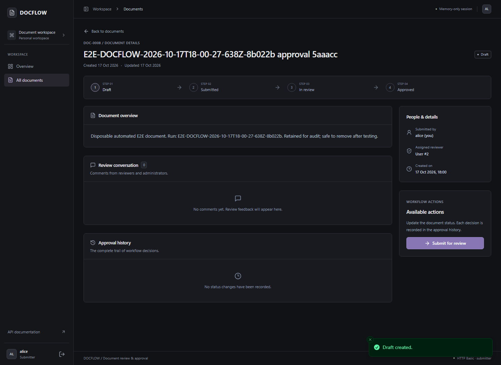
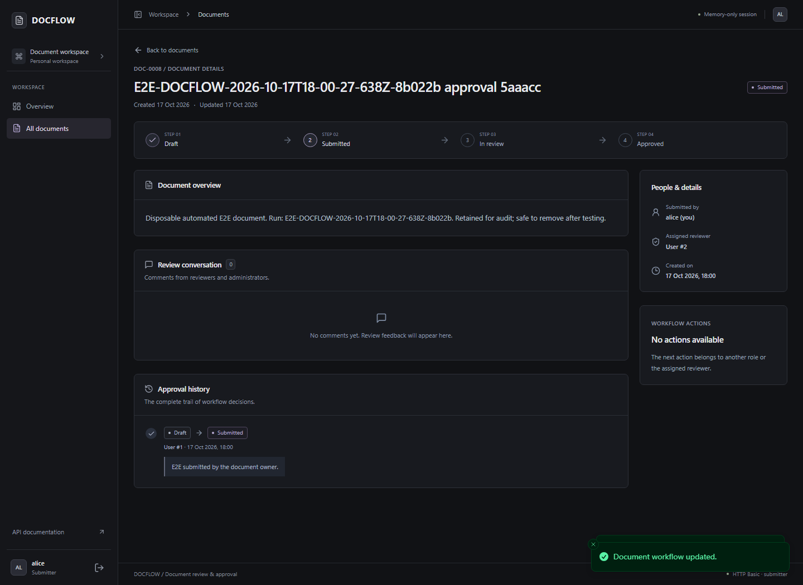
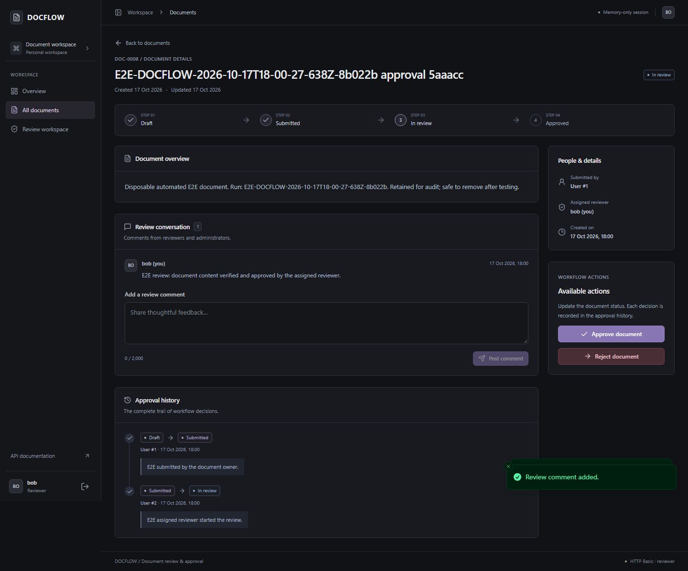
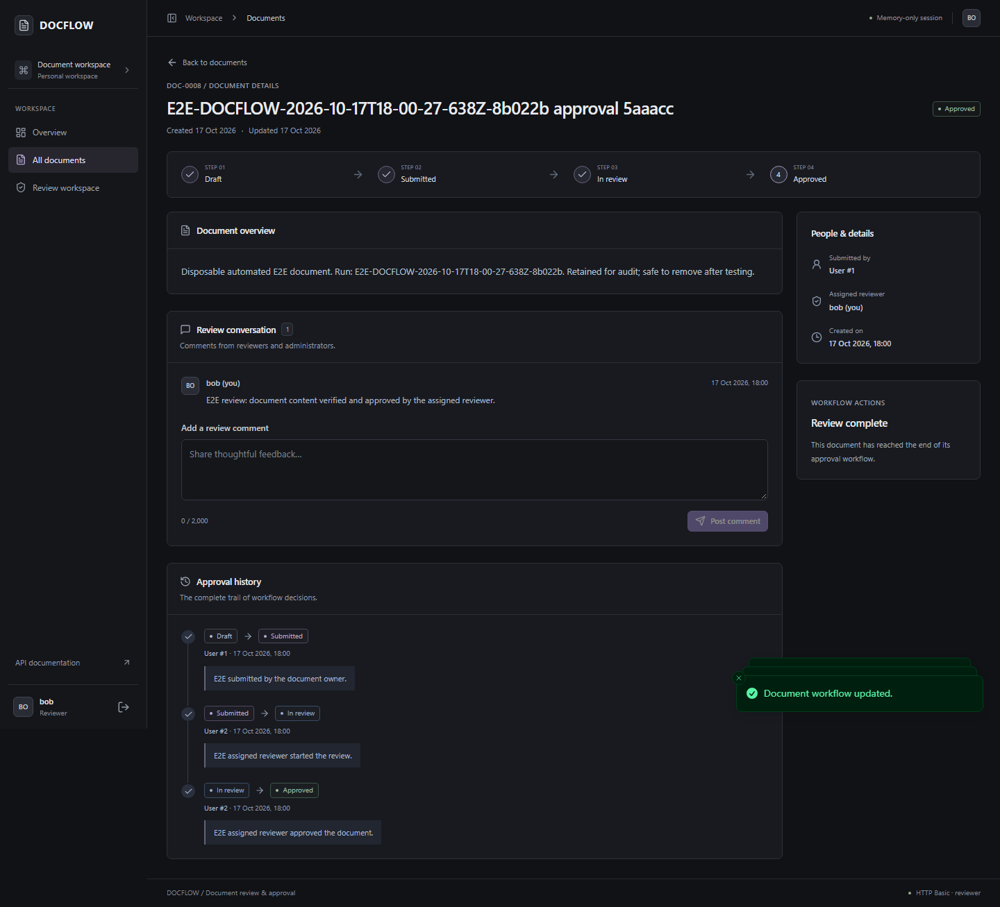
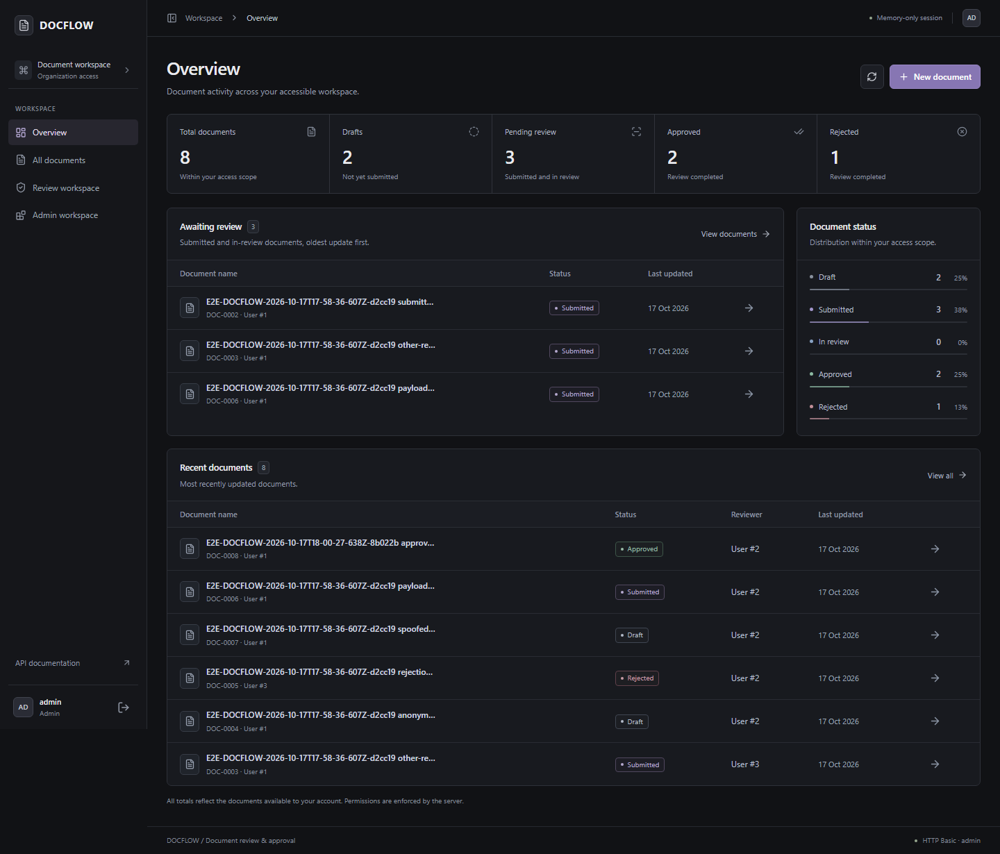
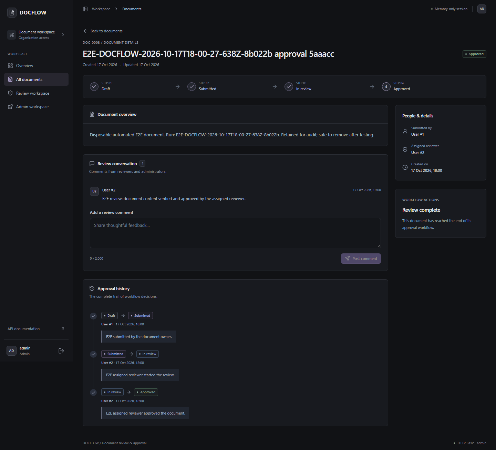
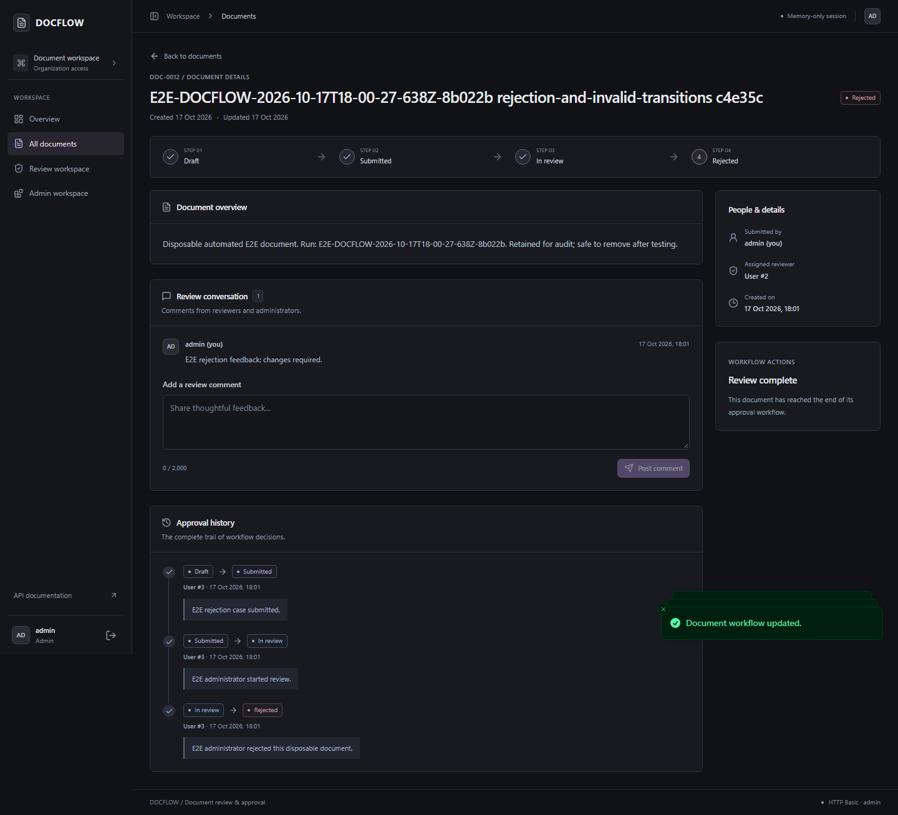

# DOCFLOW live end-to-end test report

Historical run against the original development environment. See [the publication review](../../docs/publication-readiness.md) for the latest isolated Docker verification and test counts. Screenshots in this directory belong to this historical run; the root README uses the newer captures under `docs/screenshots/`.

Executed on **17 October 2026** against the running React frontend at `http://localhost:5173`, Spring Boot at `http://localhost:8080`, and the existing PostgreSQL Docker Compose service. Chromium was driven by Playwright Test 1.64.1. No API responses were mocked and no authentication state was injected into the browser.

## Result

| Check | Passed | Failed | Skipped |
| --- | ---: | ---: | ---: |
| Final Playwright E2E suite | 9 | 0 | 0 |
| Existing frontend API/workflow unit tests | 27 | 0 | 0 |
| Complete backend suite, including PostgreSQL context startup | 10 | 0 | 0 |

The frontend production build (including strict TypeScript validation) and separate E2E TypeScript validation passed. The E2E suite was executed twice: the initial nine scenarios passed, then all nine passed again after strengthening denial-state setup and diagnostic persistence. No production bug fixes or backend changes were necessary.

## Browser workflows

| Scenario | Actual actions and assertions | Result |
| --- | --- | --- |
| A: Submitter | Signed in as alice; checked identity/role; completed the create form with bob's actual user ID; confirmed DRAFT; submitted via confirmation dialog; confirmed SUBMITTED; searched alice's document list and checked status/reviewer; signed out | Passed |
| B: Reviewer | Signed in as bob; found the assigned document in Review workspace; opened it; started review; posted a comment; approved via confirmation dialog; checked APPROVED, comment, all history entries/actors/remarks, and absence of further approval actions; signed out | Passed |
| C: Admin | Signed in as admin; checked dashboard total and approved counts incremented by one relative to preflight; found the completed document in Admin workspace; checked APPROVED, the comment and its author ID, and the complete approval history; signed out | Passed |
| Rejection | Created a separate disposable document; used real UI transitions and comment submission to reach REJECTED; verified history actors/remarks and that the terminal decision could not be reopened | Passed |

The final approval scenario completed **document #8**, created by alice (ID 1), assigned to bob (ID 2):

| Old status | New status | Recorded actor |
| --- | --- | --- |
| DRAFT | SUBMITTED | alice / user #1 |
| SUBMITTED | IN_REVIEW | bob / user #2 |
| IN_REVIEW | APPROVED | bob / user #2 |

At the admin-dashboard checkpoint there were **8 total documents and 2 approved documents**, compared with 7 total and 1 approved at the start of the second run. The screenshot records that checkpoint; subsequent security scenarios intentionally created more disposable records.

## Authorization and invalid-operation checks

Browser checks verified role-specific controls and visible data. Direct HTTP requests then tested operations unavailable in the UI, because hiding a control alone is not proof of authorization.

| Adversarial check | Actual HTTP outcome and side-effect verification |
| --- | --- |
| Alice approves a document already IN_REVIEW | 400 with the SUBMITTER permission denial, despite spoofed role/actor/reviewer fields. Status remained IN_REVIEW and history remained two entries |
| Alice posts a reviewer comment with forged reviewer identity | 400; no comment created |
| Bob searches for a document assigned to admin | UI returned no matching documents |
| Bob forces `reviewerId=admin` in a list request | 200 with an empty scoped collection; no expanded access |
| Bob reads another reviewer's document, history, or comments | 400 permission denials for all three reads |
| Bob approves another reviewer's IN_REVIEW document | 400 with assignment denial; document remained IN_REVIEW |
| Bob comments on another reviewer's document | 400; no unauthorized comment |
| Anonymous identity/list/details/history/comments reads | 401 for all five endpoints |
| Anonymous document creation, status update, comment creation with forged role | 401 for all three operations; no document/comment/history mutation |
| Anonymous navigation to protected create page | Frontend returned to sign-in |
| Admin attempts DRAFT → APPROVED, DRAFT → IN_REVIEW, or DRAFT → DRAFT | 400 invalid-transition responses |
| Admin attempts REJECTED → DRAFT or REJECTED → APPROVED | 400; document remained REJECTED and history remained three entries |
| Alice creates with forged `submitterId`, `status=APPROVED`, and `role=ADMIN` | Creation returned 200, but the server set alice as submitter and DRAFT as initial status; unknown payload fields did not grant privileges |
| Alice submits while forging `changedByUserId=admin` | Valid submission returned 200, but history recorded alice and the authenticated role remained SUBMITTER |
| Bob tries to create a document while claiming ADMIN in the payload | 400 with the reviewer-role creation denial |
| Invalid frontend login | 401 and clear credential-rejection message |
| Browser refresh after successful login | Returned to sign-in; localStorage and sessionStorage were empty |

Permission/business-rule denials currently use the backend's existing **400** contract. They are reported as such, rather than being misrepresented as 403. Authentication remains HTTP Basic.

## Diagnostics and bugs

Each browser test recorded HTTP method, path, and response status, without request headers or credentials. The final run recorded **112 browser API responses, zero 5xx responses, and zero unexpected console/runtime/connection errors**. Spring Boot logs were inspected: no new ERROR, exception, or constraint-failure entries were found during testing. Existing startup warnings about Open Session in View and enabled Swagger were not test failures.

No application bug was discovered in the requested scenarios. Changes to application components are semantic accessibility labels only: named current-status, history/comments regions, and statistic groups. They make UI assertions reliable without changing business behavior. The test runner uses a credential-redacting reporter; traces, videos, automatic screenshots, and automatic DOM snapshots are disabled.

## Isolation and retained data

The database contained **zero documents before the first run**. Each run created seven documents, all with a unique `E2E-DOCFLOW-` prefix and explicit disposable-test descriptions.

- Initial run prefix: `E2E-DOCFLOW-2026-10-17T17-58-36-607Z-d2cc19`; document IDs **1–7**.
- Final run prefix: `E2E-DOCFLOW-2026-10-17T18-00-27-638Z-8b022b`; document IDs **8–14**.
- Before the final run, all seven existing records were fingerprinted; teardown confirmed that every original ID and DTO fingerprint remained unchanged.
- There are **14 disposable documents retained** after both runs. No other records were edited. The application has no delete API, so the suite intentionally leaves its records for inspection rather than bypassing the application with SQL cleanup.
- Users alice, bob, and admin retained their original IDs and roles. No accounts were recreated or edited; PostgreSQL was not reset and no volumes or containers were removed.

| Final-run document ID | Purpose | Final state |
| --- | --- | --- |
| 8 | Main browser approval workflow | APPROVED |
| 9 | Submitter approval/comment denials | IN_REVIEW |
| 10 | Wrong-reviewer access/approval denials | IN_REVIEW |
| 11 | Anonymous-operation denials | DRAFT |
| 12 | Rejection and invalid transitions | REJECTED |
| 13 | Forged transition actor | SUBMITTED |
| 14 | Forged creation owner/role/initial state | DRAFT |

`e2e-results/isolation.json` contains the final-run manifest; `e2e-results/report.json` and `e2e-results/diagnostics/` contain sanitized test results and exact HTTP statuses. These transient artifacts are ignored by Git. Test passwords were supplied only through process environment variables and are absent from source, screenshots, and reports. Previously embedded account passwords were removed from README documentation.

## Screenshots

Screenshots were captured from real authenticated browser pages, never from login forms. They contain only the disposable records, known local usernames/roles, and their workflow evidence.

### Alice: initial draft



### Alice: submitted



### Bob: review and comment



### Bob: approved with complete history



### Admin: dashboard increment



### Admin: completed document



### Separate terminal rejection



## Commands executed

```powershell
# Frontend dependency and browser setup
npm install --save-dev @playwright/test --no-audit --no-fund
npx playwright install chromium --only-shell

# E2E credentials were provided via process environment, never a committed file.
npm run e2e:typecheck
npm run e2e

# Existing frontend checks
npm run build
npm test

# Repository root: full backend tests against the existing Compose database
$env:SPRING_DATASOURCE_URL = 'jdbc:postgresql://localhost:5433/docflow_db'
.\mvnw.cmd test
```

Read-only Docker/SQL checks inspected container state, user IDs/roles, disposable document states, history actors, and Spring Boot logs. No direct SQL mutations were performed.

## Exact files changed

- `.gitignore`: ignore transient Playwright results and local credential-environment files.
- `frontend/.dockerignore`: keep test artifacts and local credential-environment files out of frontend image build contexts.
- `README.md`: link E2E setup/report and remove embedded account passwords.
- `frontend/package.json` / `frontend/package-lock.json`: Playwright dev dependency, E2E commands, and unit-test discovery restricted to `src` so Vitest does not collect Playwright scenarios.
- `frontend/playwright.config.ts`: serial Chromium execution, real target URLs, setup/teardown, and safe artifact configuration.
- `frontend/e2e/tsconfig.json`: strict type checking for the suite/configuration.
- `frontend/e2e/environment.ts`: environment-only credentials, actual identity lookup support, role-scoped API clients, redaction, and fingerprint helpers.
- `frontend/e2e/prepare.ts`: authenticated preflight and existing-document baseline.
- `frontend/e2e/verify-isolation.ts`: original-record preservation checks and disposable-data manifest.
- `frontend/e2e/fixtures.ts`: network/console diagnostics and authenticated-only screenshots.
- `frontend/e2e/helpers.ts`: reusable UI and authorization assertions.
- `frontend/e2e/docflow.e2e.spec.ts`: the nine executed scenarios.
- `frontend/e2e/reporter.ts`: sanitized machine-readable reports and persisted diagnostics.
- `frontend/e2e/README.md`: secure setup, execution, isolation, and artifact instructions.
- `frontend/src/pages/DocumentDetails.tsx`: accessible current-status label and named history/comment regions.
- `frontend/src/pages/Dashboard.tsx`: named statistic groups for accessible verification.
- `frontend/docs/e2e-report.md`: this report.
- `frontend/docs/e2e-screenshots/01-alice-draft.png`.
- `frontend/docs/e2e-screenshots/02-alice-submitted.png`.
- `frontend/docs/e2e-screenshots/03-bob-in-review-with-comment.png`.
- `frontend/docs/e2e-screenshots/04-bob-approved-history.png`.
- `frontend/docs/e2e-screenshots/05-admin-dashboard-totals.png`.
- `frontend/docs/e2e-screenshots/06-admin-completed-document.png`.
- `frontend/docs/e2e-screenshots/07-rejected-terminal-history.png`.
- `frontend/VALIDATION.md`: link this live-run report, superseding earlier environment limitations for these scenarios.

No backend source, authentication configuration, workflow rules, schema, migrations, or Docker service configuration was changed for this task.

## Coverage limits

All requested scenarios were exercised. Browser coverage was Chromium at desktop size; Firefox, WebKit, cross-device/mobile E2E, load/concurrency testing, infrastructure failure recovery, and a full accessibility audit were not part of this run. Authorization bypass attempts were direct HTTP requests supplementing browser tests, not claims that unavailable UI controls were clicked. Delete/reassignment/file-upload/user-management operations cannot be tested because the backend does not implement them. No cleanup endpoint was fabricated.
